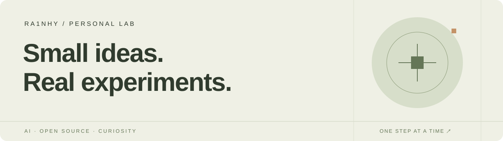
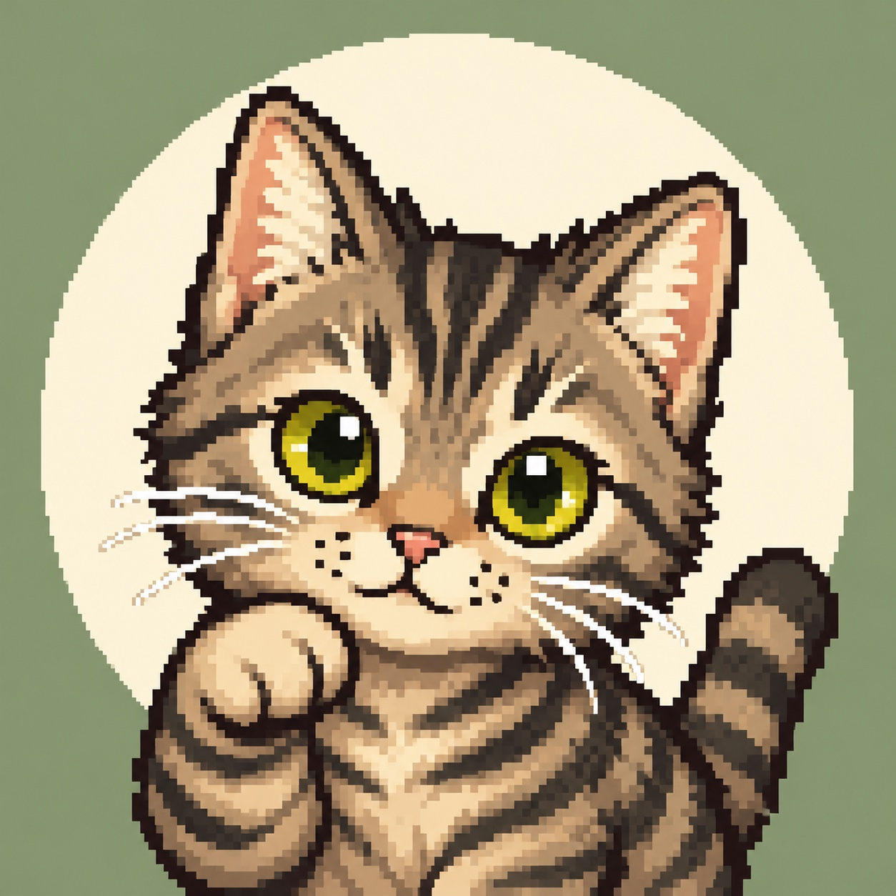

  

### 你好，我是 Ra1nhy 👋

对 AI 应用、开源工具和把想法做成原型感兴趣。

这里记录我的探索，也放一些提交给开源社区的修复和文档。

旁边是 **花椒**，我的 Codex 小伙伴。🐾

 

---

### 开源参与

以下是我提交的 Pull Request；各项的最新进展以原链接为准。

| 项目 | 提交内容 |
| :--- | :--- |
| Hugging Face Hub | [修正文档中的 Python 示例](https://github.com/huggingface/huggingface_hub/pull/5156) · [Space 管理指南中文翻译](https://github.com/huggingface/huggingface_hub/pull/5157) |
| txtai | [修复方括号字段名中的 SQL 子句识别](https://github.com/neuml/txtai/pull/1428) |
| dill | [处理纯 Python OrderedDict 视图的序列化](https://github.com/uqfoundation/dill/pull/791) |
| loky | [恢复上游 Joblib 集成测试](https://github.com/joblib/loky/pull/674) |
| xarray | [为依赖 cftime 的测试补上条件标记](https://github.com/pydata/xarray/pull/11745) |

### 持续探索

AI 工作流与智能体 · 模型与工具生态 · Python 与数据工具

仓库中的 fork 用于学习与贡献，项目原创与维护工作属于各上游社区。

  <a href="https://github.com/Ra1nhy?tab=repositories">浏览我的仓库 ↗</a>
  &nbsp; · &nbsp;
  <a href="https://github.com/Ra1nhy?tab=stars">看看我的收藏 ↗</a>

<!-- Reviewed: 2026-10-16. Update when publishing an original project or changing focus. -->
